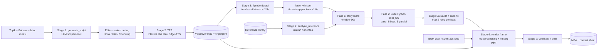
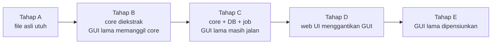
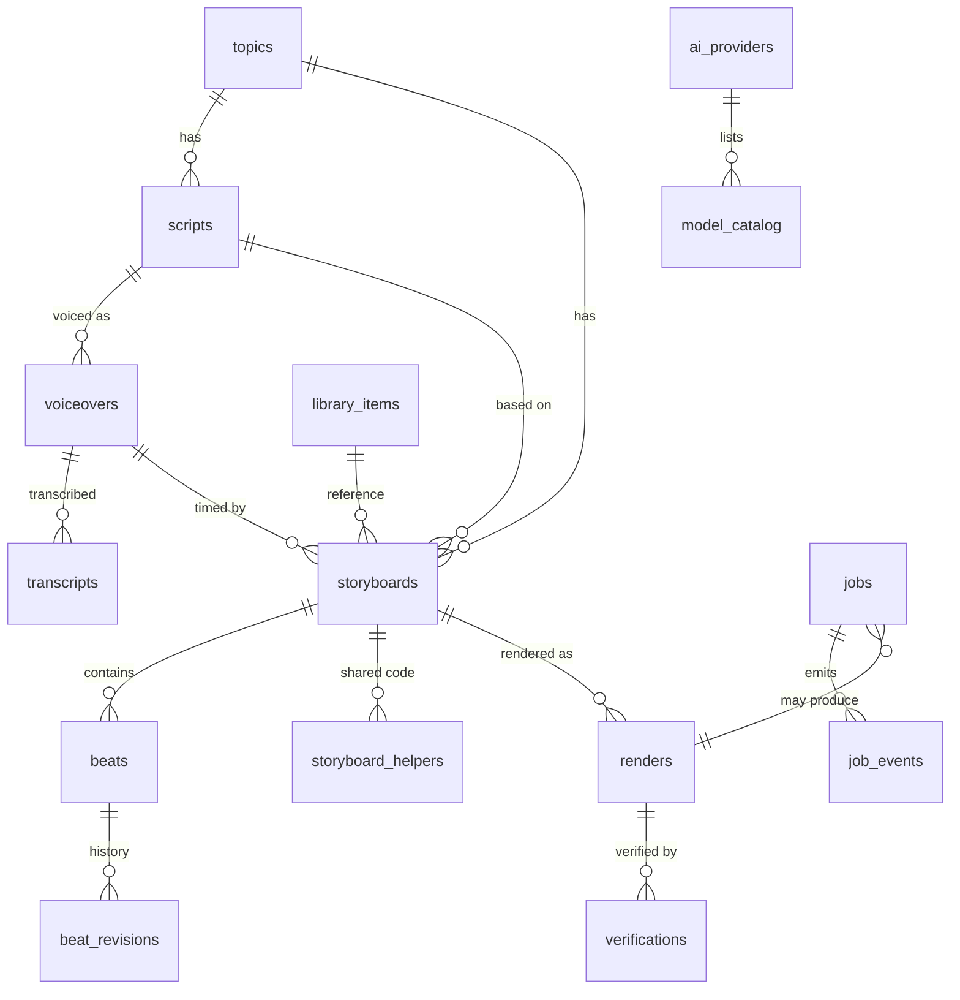
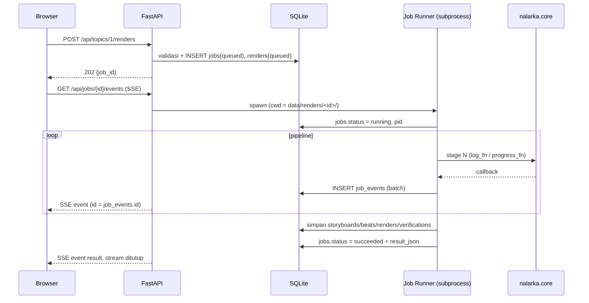

# Planning: Migrasi Nalarka Motion Graphics Studio (Desktop GUI → Web + SQLite)

| | |
|---|---|
| **Sumber analisis** | `nalarka_local.py` (3.814 baris, Nalarka Studio v8.1, Tkinter) |
| **Tanggal dokumen** | 2026-11-08 |
| **Status** | Draft untuk review |
| **Tujuan** | Mengubah GUI desktop (Tkinter) menjadi aplikasi web, **semua fungsi tetap sama**, dengan SQLite untuk topik, naskah, video generation, library, dan config |

> Catatan metodologi: isi dokumen ini berasal dari pembacaan langsung kode. Bagian yang **belum saya baca baris per baris** (isi method `VectorKit`, `friendly_api_error`, `fetch_openrouter_models`, `concat_audio_files`, `split_text_for_tts`, isi teks prompt Pass 1/2) ditandai "dipindah apa adanya" dan tidak dianalisis mendalam. Item yang berupa **rekomendasi/asumsi saya** ditandai **[Usulan]** supaya jelas bedanya dengan fakta dari kode.

---

## Daftar Isi

1. [Ringkasan Eksekutif](#1-ringkasan-eksekutif)
2. [Hasil Analisis Kode Saat Ini](#2-hasil-analisis-kode-saat-ini)
3. [Tujuan, Non-Tujuan, dan Prinsip Parity](#3-tujuan-non-tujuan-dan-prinsip-parity)
4. [Arsitektur Target](#4-arsitektur-target)
5. [Strategi Migrasi](#5-strategi-migrasi)
6. [Desain SQLite](#6-desain-sqlite)
7. [Job System & Real-Time](#7-job-system--real-time)
8. [Spesifikasi API](#8-spesifikasi-api)
9. [Desain UI Web](#9-desain-ui-web)
10. [Penyimpanan File](#10-penyimpanan-file)
11. [Keamanan](#11-keamanan)
12. [Rencana Eksekusi per Fase](#12-rencana-eksekusi-per-fase)
13. [Strategi Pengujian & Validasi Parity](#13-strategi-pengujian--validasi-parity)
14. [Deployment & Operasi](#14-deployment--operasi)
15. [Risiko & Mitigasi](#15-risiko--mitigasi)
16. [Asumsi & Pertanyaan Terbuka](#16-asumsi--pertanyaan-terbuka)
17. [Lampiran](#17-lampiran)

---

## 1. Ringkasan Eksekutif

**Temuan terpenting:** kode sudah terpisah cukup bersih antara **mesin** dan **GUI**.

- Baris **1–2790** (~73%) adalah logika murni tanpa Tkinter: LLM client, generator naskah, TTS, Whisper, VectorKit, storyboard 2-pass, audit, render, verifikasi.
- Baris **2792–3814** (~27%) adalah kelas `NalarkaStudioApp(tk.Tk)`: layout, handler tombol, dan thread worker.
- Semua fungsi mesin sudah menerima callback `log_fn` dan `progress_fn`, jadi sangat cocok dijadikan **job dengan event stream** untuk web.

**Strategi inti: "Extract → Wrap → Replace" (strangler).**

1. Pindahkan baris 1–2790 ke package `nalarka/core` **tanpa mengubah perilaku** (dijaga *characterization test* terhadap file asli).
2. Bungkus dengan lapisan **job runner + repository SQLite**.
3. Ganti kelas GUI dengan **REST API + SSE + UI web**. Setiap handler Tk punya padanan endpoint (matriks parity di §2.3).

**Keputusan teknis yang diusulkan [Usulan]:**

| Area | Pilihan | Alasan singkat |
|---|---|---|
| Backend | FastAPI + Uvicorn | async, SSE bawaan Starlette, validasi Pydantic |
| Database | SQLite (stdlib `sqlite3`, WAL) + migrasi via `PRAGMA user_version` | tanpa dependensi tambahan, cukup untuk beban studio |
| Job heavy | **Satu subprocess per job** (`python -m nalarka.jobrunner <job_id>`) | isolasi `exec()` kode AI, bisa di-kill (cancel), aman untuk `multiprocessing` spawn |
| Real-time | Server-Sent Events (SSE) dari tabel `job_events` | sederhana, otomatis reconnect, cocok log satu arah |
| Frontend | Jinja2 + HTMX + JS ringan (tanpa build step) | aplikasi form-heavy, 1 pengguna; React SPA tetap opsi |
| Deploy | Docker (ffmpeg + font), bind `127.0.0.1` default | konsisten, font terkontrol |

**Estimasi kasar** (1 developer, bukan komitmen): 5–7 minggu. Rincian di §12.

---

## 2. Hasil Analisis Kode Saat Ini

### 2.1 Peta modul (baris → paket target)

| Baris asli | Isi | Modul target |
|---|---|---|
| 37–130 | Konstanta, preset provider/model, preset suara ElevenLabs | `core/constants.py` |
| 124–131 | `logging.basicConfig` (efek samping global) | `core/logging_setup.py` (dibuat konfigurable) |
| 134–210 | `hex_to_rgb`, `rgb_to_hex`, `clamp`, easing, `rotate_point`, `sample_bezier_curve` | `core/mathutil.py` |
| 213–273 | `format_sections_to_tagged_text`, `parse_tagged_script`, `prepare_text_for_elevenlabs`, `script_fingerprint` | `core/scripttext.py` |
| 276–318 | `extract_json_safely`, `extract_python_code_safely` | `core/extractors.py` |
| 320–542 | `is_openrouter`, `make_client`, `fetch_openrouter_models`, `friendly_api_error`, `_chat_text`, `call_ai_json`, `call_ai_python_code` | `core/llm.py` |
| 544–672 | `script_word_budget`, `script_section_count`, `estimate_video_seconds`, `check_script_fits`, `generate_script` | `core/script.py` |
| 675–845 | `fetch_elevenlabs_voices`, `split_text_for_tts`, `concat_audio_files`, `generate_elevenlabs_tts`, Edge-TTS | `core/tts.py` |
| 847–895 | `generate_synthetic_ambient_bgm` | `core/bgm.py` |
| 897–922 | `get_audio_duration` (ffprobe), `extract_word_timestamps` (faster-whisper) | `core/audio.py` |
| 925–1006 | `scan_reference_library`, `analyze_reference_video` | `core/reference.py` |
| 1009–≈1702 | Canvas kertas bintik, `load_font`, kelas `VectorKit` | `core/vectorkit.py` |
| 1705–1796 | `PASS1_STORYBOARD_PROMPT`, `PASS2_PYTHON_VECTOR_ARTIST_PROMPT`, konstanta layout/warna/transisi | `core/prompts.py`, `core/constants.py` |
| 1797–1972 | Validasi AST kode scene, namespace, `split_scene_code`, `register_source`, `build_namespace`, `write_scene_module_file` | `core/scene_code.py` |
| 1974–2207 | `sanitize_scenes`, `compress_words`, `storyboard_windows`, `plan_storyboard`, `generate_scene_code_batches`, `generate_two_pass_storyboard_and_code` | `core/storyboard.py` |
| 2209–2368 | `render_single_beat_canvas`, `rewrite_single_beat_function_with_ai`, `audit_and_fix_beats` | `core/audit.py` |
| 2370–2476 | `composite_transition`, `render_frame`, `render_beat_preview_sheet` | `core/frames.py` |
| 2478–2640 | `_mp_*`, `default_render_workers`, `render_video_pipeline` (ffmpeg + multiprocessing) | `core/render.py` |
| 2642–2790 | `run_verification_suite` (7 cek) | `core/verify.py` |
| **2792–3814** | **`NalarkaStudioApp` (GUI) + `__main__`** | **Diganti: `api/`, `jobs/`, `web/`** |

### 2.2 Alur pipeline (Stage 1–7)



**Urutan & milestone progress di `_worker_full_render`** (harus dipertahankan): auto-TTS bila file voiceover tidak ada (8%) → ffprobe (15%) → reference (22%) → Whisper (32%) → Pass 1/2 (45%) → audit (62–70%) → tulis `timeline_plan.json` → BGM sintetis bila perlu → render (persen frame) → verifikasi (96%) → selesai (100%).

**Guard yang harus identik:**

1. `check_script_fits` dijalankan **sebelum** TTS berbayar (toleransi `TTS_OVERSHOOT_TOLERANCE = 1.12`).
2. Jika voiceover dibuat dari naskah berbeda (sidecar `.script.sha1` ≠ fingerprint naskah di editor) → **HARD STOP**.
3. Jika `ceil(durasi_vo + 2.5) > max_dur` → **HARD STOP**.
4. Jika file voiceover tidak ada dan editor kosong → error `FileNotFoundError`.

### 2.3 Inventaris fitur GUI dan padanan web (matriks parity)

Setiap baris adalah **kontrak**: web belum dianggap selesai sebelum semua ID di bawah lulus (lihat §13.6).

**Bagian 1 — AI Provider**

| ID | Fitur desktop | Handler / fungsi inti | Padanan web |
|---|---|---|---|
| F-01 | Pilih provider (Custom OpenAI-compatible `oao.ai.id` / OpenRouter); stash & restore field per provider saat ganti | `_on_provider_changed`, `_stash_provider_fields`, `_apply_provider_fields` | Halaman Settings: select provider; tiap provider punya baris sendiri di `ai_providers` |
| F-02 | Hint teks per provider | `_update_provider_hint` | Teks bantuan dinamis di bawah select |
| F-03 | Base URL, API Key (masked), Coder Model (Stage 5), Script Model (Stage 1), combo **editable** | var Tk | Input + `datalist`; key password-field (lihat §11.1) |
| F-04 | Save Config | `_save_config` | `PUT /api/providers/{key}` + `PUT /api/config` |
| F-05 | Test Vector Model (ping JSON `{"status":"ok"}`) | `_worker_test_ai` → `call_ai_json` | Job `test_ai` |
| F-06 | Fetch OpenRouter Models (update kedua combo, log jumlah total & gratis) | `_worker_fetch_or_models` → `fetch_openrouter_models` | Job `fetch_openrouter_models`; hasil disimpan di `model_catalog` |
| F-07 | Fallback key dari env `OPENROUTER_API_KEY` / `NALARKA_API_KEY` bila field kosong | `make_client` | Dipertahankan di core |
| F-08 | Migrasi config lama format single-endpoint | `_load_config` cabang legacy | Importer config (§6.5) |

**Bagian 2A — Topik & Naskah**

| ID | Fitur desktop | Handler / fungsi inti | Padanan web |
|---|---|---|---|
| F-10 | Input topik (default contoh "Kenapa Suara Sendiri…") | `topic_var` | Form topik; tabel `topics` |
| F-11 | Bahasa: Indonesian / English | `lang_var` | Select; kolom `topics.language` |
| F-12 | Max durasi: preset `60/90/120/180/300/600`, bebas diketik, clamp **15–900** | `_get_max_duration` | Input + datalist; validasi sama di server dan klien |
| F-13 | Hint durasi (rentang kata, jumlah section, rentang beat, label "EXTENDED MODE" bila >60) | `_on_max_duration_changed` | `GET /api/duration-hint?d=` (rumus tetap di core) |
| F-14 | Generate Structured Script (AI) + 1x retry persingkat bila >110% budget | `_worker_generate_script` → `generate_script` | Job `generate_script` → baris baru di `scripts` |
| F-15 | Editor naskah bertag `[Hook]`, `[Inti N]`, `[Penutup]` (+ contoh default) | `ScrolledText` | `<textarea>`; simpan versi manual/edit di `scripts` |
| F-16 | Info naskah: jumlah kata, estimasi voice, estimasi video, flag "OVER CAP" | `script_info_var` | `POST /api/scripts/estimate` (live, debounce) |
| F-17 | Copy Clean Text (tag dibuang) | `_copy_clean_text_clipboard` | `navigator.clipboard` + `GET /api/scripts/{id}/clean-text` |
| F-18 | Peringatan topik kosong | `messagebox.showwarning` | Validasi inline + toast |

**Bagian 2B — TTS**

| ID | Fitur desktop | Handler / fungsi inti | Padanan web |
|---|---|---|---|
| F-20 | Provider TTS: ElevenLabs API v1 / Edge-TTS (gratis) | `tts_provider_var` | Select di Settings TTS |
| F-21 | ElevenLabs API key, voice (preset + editable), model (`eleven_multilingual_v2`, `eleven_flash_v2_5`, `eleven_turbo_v2_5`) | var Tk | Form TTS |
| F-22 | Stability 0.50, Similarity 0.75, Style 0.15 (0–1, step 0.05), Speaker Boost, Add `<break time="0.4s"/>` | Spinbox/Checkbutton | Input number + checkbox |
| F-23 | Fetch My Voices; otomatis memilih voice bernama mengandung "bagas" bila ada | `_worker_fetch_el_voices` | Job `fetch_el_voices`; cache di `tts_voices`; **perilaku "bagas" dipertahankan** |
| F-24 | Generate Voiceover Audio Now: `check_script_fits` dulu → sintesis → tulis sidecar fingerprint → log durasi & "Locked Video Target" | `_worker_tts`, `_synthesize_voiceover_now` | Job `generate_tts` → baris `voiceovers` (fingerprint di DB menggantikan sidecar) |
| F-25 | Edge voice otomatis: `en-US-ChristopherNeural` / `id-ID-ArdiNeural` | `_synthesize_voiceover_now` | Dipertahankan |
| F-26 | Chunking teks (`EL_CHUNK_CHARS = 4500`) + `previous_text`/`next_text` + concat ffmpeg | `generate_elevenlabs_tts` | Dipertahankan di core |
| F-27 | Pesan error TTS berupa dialog | `messagebox.showerror` | Toast error + entri log |

**Bagian 3 — Library, Aset, Render**

| ID | Fitur desktop | Handler / fungsi inti | Padanan web |
|---|---|---|---|
| F-30 | Pilihan referensi: "None (Default Nalarka Flat-Vector Palette)" + file di folder library | `_refresh_reference_library` | Dropdown dari `library_items` |
| F-31 | Refresh Library (scan folder, hitung file) | `scan_reference_library` | `POST /api/library/scan` |
| F-32 | Set Library Folder | `_choose_ref_library_dir` | Setting `library.dir` (path di server) |
| F-33 | Import File to Library (mp4, mov, mkv, webm, png, jpg, jpeg, webp) | `_import_file_to_library` | Upload file |
| F-34 | Pilih referensi → simpan config + `analyze_reference_video` | `_on_reference_selected` | Simpan `selected_reference_id`; profil disimpan di `library_items.profile_json` |
| F-35 | Voiceover Audio path + Browse | `_browse_vo` | Pilih dari `voiceovers`/upload audio (mp3, wav, m4a, ogg) |
| F-36 | Background Music path + Browse | `_browse_bgm` | Pilih/upload di `library_items` kind `bgm` |
| F-37 | Orientation: Match Reference / 1080x1920 / 1920x1080 | `_resolve_dimensions` | Select; logika di core |
| F-38 | Whisper: tiny / base / small | `whisper_var` | Select |
| F-39 | Auto-Synth BGM | `synth_bgm_var` | Checkbox |
| F-40 | Render workers 1–16 (default `min(8, cpu-1)`) | `_get_workers` | Input number; default dihitung server |
| F-41 | Output path | `out_path_var` | Nama file output (disanitasi) di folder render |
| F-42 | **Generate Topic Vectors, Audit & Render MP4** (pipeline penuh) | `_worker_full_render` | Job `full_render` |
| F-43 | **Verify MP4** (7 cek) | `_worker_verify_only` | Job `verify_mp4` |
| F-44 | Beat Inspector: daftar beat `Beat #NN [start-end] (bg): ringkasan` | `_populate_scene_inspector` | Tabel/dropdown dari `beats` |
| F-45 | Regenerate Selected Beat & Re-Render MP4 + Custom Note (note ditambahkan ke `visual_blueprint`) | `_worker_reroll_scene` | Job `reroll_beat`; revisi di `beat_revisions` |
| F-46 | Preview Selected Beat (PNG contact sheet 6 frame) | `_worker_preview_beat` | Job `preview_beat`; PNG tampil di modal |

**Bagian 4 — Progress & Log**

| ID | Fitur desktop | Padanan web |
|---|---|---|
| F-50 | Progress bar + teks status | `<progress>` + status per job via SSE |
| F-51 | Log real-time (format `[HH:MM:SS] pesan`) | Konsol `<pre>` dari SSE, tersimpan di `job_events` |
| F-52 | File log `nalarka_debug.log`, `ffmpeg_render.log` | Log terotasi di `data/logs/`, `ffmpeg.log` per render |
| F-53 | Dialog sukses (info durasi, frame, file output, contact sheet) | Kartu hasil + toast |
| F-54 | Tombol dinonaktifkan selama worker berjalan | Kunci per jenis job (§7.3) |

### 2.4 State, file global, dan persistensi saat ini

**State hanya di memori** (hilang saat aplikasi ditutup): `current_script_data`, `current_plan`, `current_namespace`, `current_words`. Konsekuensi: Beat Inspector, Re-Roll, dan Preview hanya berfungsi setelah pipeline penuh dijalankan pada sesi yang sama.

**Yang disimpan di `config_nalarka.json`** (`_save_config`): provider aktif + per-provider (base_url, api_key, coder_model, script_model), `tts_provider`, kunci/voice/model/stability/similarity/style ElevenLabs, `ref_library_dir`, `selected_reference`, `max_duration`, `render_workers`.

**Yang TIDAK disimpan** (hilang tiap restart): topik, bahasa, isi naskah, Speaker Boost, SSML break, path voiceover/BGM/output, orientasi, Whisper size, Auto-Synth BGM. Di web semuanya masuk DB (peningkatan, tidak merusak parity).

**File global relatif terhadap working directory** (sumber tabrakan di web):

| File | Dibuat oleh | Masalah di web |
|---|---|---|
| `config_nalarka.json` | `_save_config` | diganti DB |
| `nalarka_debug.log`, `ffmpeg_render.log` | logging / render | satu file untuk semua pengguna/job |
| `Suara_Voiceover.mp3` + `.script.sha1` | TTS | tabrakan antar topik |
| `synthetic_ambient_bgm.wav` | BGM synth | dipakai ulang diam-diam saat reroll |
| `generated_scenes.py`, `timeline_plan.json` | storyboard/audit | tertimpa tiap run |
| `check/` | verifikasi (`shutil.rmtree` tiap kali) | job paralel saling menghapus |
| `preview_beat_NN.png` | preview | tabrakan |
| `references_library/` | library | perlu pemetaan ke DB |

### 2.5 Temuan khusus yang memengaruhi desain

1. **Referensi hanya menentukan orientasi.** `analyze_reference_video` membaca lebar/tinggi saja; palet selalu palet default, `avg_cut_seconds = 2.4` dan `recommended_bpm = 116` konstan. Jadi skema library tidak perlu menyimpan analisis visual kompleks. Fungsi ini juga tidak melakukan logging, sehingga memilih referensi praktis hanya "simpan config".
2. **Eksekusi kode AI memakai `exec()`.** `validate_scene_source` (AST gate) mendokumentasikan dirinya sendiri sebagai *"not a hardened sandbox"*. Di desktop 1 pengguna ini wajar; di web risikonya naik (§11.2).
3. **Namespace tidak bisa di-pickle**, sehingga worker render membangun ulang fungsi dari sumber teks (`build_namespace(plan["scene_sources"])`). Ini justru memudahkan persistensi: **sumber kode per beat disimpan di DB, namespace dibangun ulang kapan saja.**
4. **Font bergantung platform.** `load_font` mencari Arial Black/Impact (macOS, Windows) lalu fallback `DejaVuSans-Bold` (Linux). Render di server Linux akan **tampak berbeda** dari desktop macOS/Windows kecuali font disamakan (§14.3).
5. **Reroll me-render ulang seluruh MP4** (tidak inkremental). Dipertahankan; optimasi bisa menyusul.
6. **Semantik BGM berbeda** antara full render (path bila ada → sintesis bila `Auto-Synth` aktif) dan reroll (path atau `synthetic_ambient_bgm.wav` bila file ada). Harus direplikasi persis dan diuji (§13.2).
7. **Reroll mengubah `visual_blueprint`** dengan menambahkan `(custom note)` ke teks. Dipertahankan, dan versi sebelumnya dicatat di `beat_revisions`.
8. **Progress bar render melompat mundur**: `render_video_pipeline` memanggil `progress_fn(pct_frame)` dengan 0–100, setelah milestone 62–70%. Opsional (kosmetik): petakan fase render ke rentang 70–95 hanya di lapisan UI.
9. **Daftar model OpenRouter hasil fetch tidak persisten** (hanya di memori). Di web disimpan di `model_catalog`.
10. **Offset audio** `+1.0s` pada timestamp Whisper konsisten dengan `adelay=1000` di filter ffmpeg dan prompt Pass 1 ("Voiceover starts at 1.0s"). Tidak boleh diubah.
11. **Dependensi runtime:** Pillow, numpy, openai (SDK), faster-whisper (import malas), edge-tts (import malas), ffmpeg & ffprobe di PATH.

---

## 3. Tujuan, Non-Tujuan, dan Prinsip Parity

### 3.1 Tujuan

- G1. Semua fitur F-01…F-54 berjalan di web dengan hasil setara.
- G2. Data (topik, naskah, voiceover, storyboard/beat, render, library, config) tersimpan di SQLite dan bertahan antar restart.
- G3. Pipeline panjang berjalan sebagai job di latar belakang dengan log/progress real-time, dan tetap bisa dipantau setelah halaman di-refresh.
- G4. Migrasi tanpa kehilangan data pengguna saat ini (config JSON, `references_library/`).

### 3.2 Non-tujuan (fase ini)

- Tidak mengubah algoritma render, prompt, konstanta, atau urutan stage.
- Tidak menambah multi-tenant/akun pengguna penuh (lihat §16 untuk keputusan).
- Tidak mengganti ffmpeg, Pillow, atau faster-whisper.

### 3.3 Prinsip parity

1. **Core dipindah apa adanya**; perubahan hanya yang diperlukan untuk parameterisasi path dan callback.
2. **Perilaku ≠ implementasi**: pesan log, milestone progress, guard HARD STOP, dan rumus durasi adalah bagian dari kontrak.
3. **Peningkatan boleh** (persistensi, cancel, histori) selama tidak mengubah hasil jalur normal, dan diberi label *enhancement* agar terlacak.
4. **Bukti, bukan klaim**: parity dibuktikan oleh tes karakterisasi dan perbandingan hash frame (§13).

---

## 4. Arsitektur Target

```mermaid
flowchart TB
  subgraph Browser
    UI[UI: Jinja + HTMX + JS]
  end
  subgraph API[API Process - FastAPI]
    REST[REST /api/*]
    SSE[SSE /api/jobs/id/events]
    LIGHT[Job ringan: thread pool\ntest_ai, fetch models/voices, estimate]
    DISP[Job dispatcher / scheduler]
  end
  subgraph DB[(SQLite WAL)]
    T1[topics, scripts, voiceovers]
    T2[storyboards, beats, renders]
    T3[library_items, settings, providers]
    T4[jobs, job_events]
  end
  subgraph WORKERS[Job Runner - subprocess per job]
    JR[nalarka.jobrunner]
    CORE[nalarka.core\nmesin asli]
    POOL[multiprocessing spawn pool]
    FF[ffmpeg / ffprobe]
  end
  FS[(data/ folder\nmedia, render, log)]

  UI --> REST
  UI --> SSE
  REST --> DB
  REST --> LIGHT
  REST --> DISP
  DISP -->|spawn + cwd=run dir| JR
  JR --> CORE
  CORE --> POOL
  CORE --> FF
  JR -->|tulis event + hasil| DB
  JR --> FS
  SSE -->|tail job_events| DB
  REST --> FS
```

### 4.1 Struktur folder [Usulan]

```
nalarka-web/
├─ legacy/nalarka_local.py          # file asli, dibekukan sebagai oracle tes
├─ nalarka/
│  ├─ core/                         # hasil ekstraksi baris 1-2790 (tanpa tkinter)
│  ├─ db/
│  │  ├─ connection.py              # PRAGMA, thread-local conn
│  │  ├─ migrations/0001_init.sql ...
│  │  └─ repos/                     # topics, scripts, voiceovers, library, storyboards, renders, jobs, settings
│  ├─ services/                     # orkestrasi: pipeline.py (pengganti _worker_*), plan_assembler.py, secrets.py
│  ├─ jobs/                         # dispatcher.py, jobrunner.py, events.py, locks.py
│  ├─ api/                          # routers + schemas (Pydantic)
│  └─ web/                          # templates/, static/
├─ tests/                           # characterization, db, api, e2e
├─ data/                            # (runtime, di-.gitignore) nalarka.db, media/, renders/, library/, logs/
├─ Dockerfile, docker-compose.yml
└─ pyproject.toml
```

---

## 5. Strategi Migrasi

### 5.1 Pendekatan: Strangler dengan "GUI-on-core" sebagai jembatan



Alasan: pada Tahap B, GUI lama dijalankan **di atas core baru**. Jika render hasilnya identik dengan file asli, berarti ekstraksi tidak merusak apa pun, **sebelum** ada satu baris kode web pun. Kesalahan terdeteksi lebih awal dan terisolasi.

### 5.2 Keputusan desain dan alasannya

| # | Keputusan [Usulan] | Alternatif | Alasan memilih |
|---|---|---|---|
| D1 | Subprocess per job heavy | Thread di proses API | `exec()` kode AI terisolasi; bisa di-kill; `multiprocessing.spawn` aman; crash tidak menjatuhkan API |
| D2 | SQLite sebagai antrian + event store | Redis/Celery | Tidak menambah infrastruktur; beban rendah; cukup untuk 1 server |
| D3 | Plan dinormalisasi (`storyboards`+`beats`+`storyboard_helpers`) dan **dirakit ulang** menjadi dict `plan` | Simpan satu blob JSON | Beat bisa dikueri/diedit; **tes round-trip** menjamin dict identik dengan `timeline_plan.json` |
| D4 | `extra_json` pada beat | Kolom tetap saja | `sanitize_scenes` mempertahankan field tak dikenal dari model (`d = dict(s)`); tanpa ini data hilang |
| D5 | Fingerprint voiceover di DB | Pertahankan sidecar `.script.sha1` | Lebih konsisten; sidecar tetap ditulis opsional untuk kompatibilitas |
| D6 | Path dibuat eksplisit (`RunContext`) **dan** cwd subprocess = folder run | Hanya `os.chdir` | `chdir` global tidak aman bila ada thread; kombinasi keduanya membuat Tahap 2 aman dan bertahap |
| D7 | Cache transkrip Whisper **default mati** | Selalu cache | Parity: desktop selalu menjalankan ulang Whisper; cache jadi opsi setelah terbukti identik |

### 5.3 Pola perubahan kode pada core

| Perubahan | Contoh | Risiko |
|---|---|---|
| Hapus `import tkinter`, `webbrowser` | baris 27–29, 22 | nol |
| `logging.basicConfig` pindah ke fungsi `setup_logging(path)` | baris 124–131 | rendah |
| Path hard-coded → parameter dengan default lama | `write_scene_module_file(plan, path)`, `FFMPEG_LOG_FILE`, `Path("check")`, `preview_beat_NN.png` | rendah, default menjaga kompatibilitas |
| Tambah `cancel_event` opsional pada loop render & panggilan LLM berurutan | `render_video_pipeline` | rendah; *enhancement* |
| `log_fn`/`progress_fn` → emitter ke `job_events` | `services/pipeline.py` | rendah, signature tetap |

---

## 6. Desain SQLite

### 6.1 Pemetaan lima domain yang diminta

| Domain | Tabel utama | Menggantikan |
|---|---|---|
| **Topik** | `topics` | `topic_var`, `lang_var`, `max_dur_var` |
| **Script** | `scripts`, `voiceovers`, `transcripts` | `script_text`, `current_script_data`, `Suara_Voiceover.mp3(.script.sha1)`, `current_words` |
| **Video generation** | `storyboards`, `beats`, `storyboard_helpers`, `beat_revisions`, `renders`, `verifications`, `jobs`, `job_events` | `current_plan`, `current_namespace`, `generated_scenes.py`, `timeline_plan.json`, `output_*.mp4`, `check/`, log |
| **Library** | `library_items` | `references_library/`, `ref_choice_var`, `bgm_path_var` |
| **Config** | `app_settings`, `ai_providers`, `model_catalog`, `tts_voices` | `config_nalarka.json` |

### 6.2 Diagram relasi



### 6.3 Skema (DDL) [Usulan]

```sql
-- ===== Koneksi (di-set tiap koneksi) =====
PRAGMA journal_mode = WAL;
PRAGMA foreign_keys = ON;
PRAGMA busy_timeout = 5000;
PRAGMA synchronous = NORMAL;

-- ===== CONFIG =====
CREATE TABLE app_settings (
  key         TEXT PRIMARY KEY,                 -- mis. 'render.max_duration', 'tts.stability'
  value       TEXT NOT NULL,
  value_type  TEXT NOT NULL DEFAULT 'string'
              CHECK (value_type IN ('string','int','float','bool','json')),
  updated_at  TEXT NOT NULL DEFAULT (datetime('now'))
);

CREATE TABLE ai_providers (
  key          TEXT PRIMARY KEY CHECK (key IN ('custom','openrouter')),
  label        TEXT NOT NULL,
  base_url     TEXT NOT NULL,
  api_key_enc  BLOB,                            -- terenkripsi (Fernet); NULL = pakai env var
  coder_model  TEXT NOT NULL,
  script_model TEXT NOT NULL,
  is_active    INTEGER NOT NULL DEFAULT 0 CHECK (is_active IN (0,1)),
  updated_at   TEXT NOT NULL DEFAULT (datetime('now'))
);
CREATE UNIQUE INDEX ux_ai_providers_active ON ai_providers(is_active) WHERE is_active = 1;

CREATE TABLE model_catalog (
  provider_key TEXT NOT NULL REFERENCES ai_providers(key) ON DELETE CASCADE,
  model_id     TEXT NOT NULL,
  role         TEXT NOT NULL CHECK (role IN ('coder','script')),
  is_free      INTEGER NOT NULL DEFAULT 0,
  source       TEXT NOT NULL CHECK (source IN ('preset','fetched')),
  fetched_at   TEXT,
  PRIMARY KEY (provider_key, model_id, role)
);

CREATE TABLE tts_voices (
  voice_id   TEXT PRIMARY KEY,
  name       TEXT NOT NULL,
  category   TEXT,
  label      TEXT NOT NULL,                     -- "Nama [category] (voice_id)" seperti combo desktop
  source     TEXT NOT NULL CHECK (source IN ('preset','fetched')),
  fetched_at TEXT
);

-- ===== TOPIK =====
CREATE TABLE topics (
  id           INTEGER PRIMARY KEY AUTOINCREMENT,
  title        TEXT NOT NULL CHECK (length(trim(title)) > 0),
  language     TEXT NOT NULL DEFAULT 'Indonesian' CHECK (language IN ('Indonesian','English')),
  max_duration INTEGER NOT NULL DEFAULT 60 CHECK (max_duration BETWEEN 15 AND 900),
  notes        TEXT,
  created_at   TEXT NOT NULL DEFAULT (datetime('now')),
  updated_at   TEXT NOT NULL DEFAULT (datetime('now')),
  archived_at  TEXT
);
CREATE INDEX ix_topics_updated ON topics(updated_at DESC) WHERE archived_at IS NULL;

-- ===== SCRIPT =====
CREATE TABLE scripts (
  id               INTEGER PRIMARY KEY AUTOINCREMENT,
  topic_id         INTEGER NOT NULL REFERENCES topics(id) ON DELETE CASCADE,
  version          INTEGER NOT NULL,
  source           TEXT NOT NULL CHECK (source IN ('ai','manual','edited')),
  model            TEXT,
  raw_text         TEXT NOT NULL,               -- isi editor bertag [Hook]/[Inti N]/[Penutup]
  clean_text       TEXT NOT NULL,               -- hasil parse_tagged_script
  sections_json    TEXT NOT NULL,               -- [{"tag","text"}, ...]
  fingerprint      TEXT NOT NULL,               -- script_fingerprint() (sha1)
  word_count       INTEGER NOT NULL,
  est_voice_sec    REAL NOT NULL,
  est_video_sec    INTEGER NOT NULL,
  word_budget_lo   INTEGER,
  word_budget_hi   INTEGER,
  max_duration_at  INTEGER NOT NULL,            -- cap saat dibuat
  is_current       INTEGER NOT NULL DEFAULT 0 CHECK (is_current IN (0,1)),
  created_at       TEXT NOT NULL DEFAULT (datetime('now')),
  UNIQUE (topic_id, version)
);
CREATE UNIQUE INDEX ux_scripts_current ON scripts(topic_id) WHERE is_current = 1;

CREATE TABLE voiceovers (
  id                 INTEGER PRIMARY KEY AUTOINCREMENT,
  topic_id           INTEGER NOT NULL REFERENCES topics(id) ON DELETE CASCADE,
  script_id          INTEGER REFERENCES scripts(id) ON DELETE SET NULL,
  origin             TEXT NOT NULL CHECK (origin IN ('generated','uploaded')),
  provider           TEXT,                      -- 'elevenlabs' | 'edge'
  voice              TEXT,
  model_id           TEXT,
  params_json        TEXT,                      -- stability, similarity, style, boost, ssml
  file_path          TEXT NOT NULL,             -- relatif terhadap data/
  duration_sec       REAL,                      -- hasil ffprobe
  total_dur_locked   INTEGER,                   -- ceil(duration + 2.5)
  script_fingerprint TEXT,                      -- NULL untuk audio unggahan (guard dilewati, seperti tanpa sidecar)
  created_at         TEXT NOT NULL DEFAULT (datetime('now'))
);
CREATE INDEX ix_voiceovers_topic ON voiceovers(topic_id, created_at DESC);

CREATE TABLE transcripts (                      -- hasil faster-whisper
  id            INTEGER PRIMARY KEY AUTOINCREMENT,
  voiceover_id  INTEGER NOT NULL REFERENCES voiceovers(id) ON DELETE CASCADE,
  whisper_size  TEXT NOT NULL CHECK (whisper_size IN ('tiny','base','small')),
  language      TEXT,
  words_json    TEXT NOT NULL,                  -- [{"word","start","end"}] (sudah +1.0s)
  created_at    TEXT NOT NULL DEFAULT (datetime('now'))
);

-- ===== LIBRARY =====
CREATE TABLE library_items (
  id            INTEGER PRIMARY KEY AUTOINCREMENT,
  kind          TEXT NOT NULL CHECK (kind IN ('reference','bgm','voiceover_upload')),
  filename      TEXT NOT NULL,
  file_path     TEXT NOT NULL,                  -- relatif terhadap data/library
  media_type    TEXT NOT NULL CHECK (media_type IN ('video','image','audio')),
  size_bytes    INTEGER,
  sha256        TEXT,
  width         INTEGER,
  height        INTEGER,
  profile_json  TEXT,                           -- hasil analyze_reference_video (kind='reference')
  origin        TEXT NOT NULL DEFAULT 'upload' CHECK (origin IN ('upload','scan')),
  created_at    TEXT NOT NULL DEFAULT (datetime('now')),
  UNIQUE (kind, filename)
);

-- ===== VIDEO GENERATION =====
CREATE TABLE storyboards (
  id                INTEGER PRIMARY KEY AUTOINCREMENT,
  topic_id          INTEGER NOT NULL REFERENCES topics(id) ON DELETE CASCADE,
  script_id         INTEGER REFERENCES scripts(id) ON DELETE SET NULL,
  voiceover_id      INTEGER REFERENCES voiceovers(id) ON DELETE SET NULL,
  transcript_id     INTEGER REFERENCES transcripts(id) ON DELETE SET NULL,
  reference_item_id INTEGER REFERENCES library_items(id) ON DELETE SET NULL,
  coder_model       TEXT NOT NULL,
  total_dur         INTEGER NOT NULL,
  palette_json      TEXT NOT NULL,
  is_current        INTEGER NOT NULL DEFAULT 0 CHECK (is_current IN (0,1)),
  created_at        TEXT NOT NULL DEFAULT (datetime('now'))
);
CREATE UNIQUE INDEX ux_storyboards_current ON storyboards(topic_id) WHERE is_current = 1;

CREATE TABLE beats (
  id               INTEGER PRIMARY KEY AUTOINCREMENT,
  storyboard_id    INTEGER NOT NULL REFERENCES storyboards(id) ON DELETE CASCADE,
  beat_no          INTEGER NOT NULL,            -- 1-based (beat_01 ...)
  start_sec        REAL NOT NULL,
  end_sec          REAL NOT NULL,
  layout           TEXT,
  bg_color         TEXT,
  transition       TEXT,
  summary          TEXT,
  visual_blueprint TEXT,
  dot_index        INTEGER,
  lines_json       TEXT,
  extra_json       TEXT,                        -- field lain dari model, dipertahankan utuh
  source_code      TEXT,                        -- def beat_NN(v): ...
  code_status      TEXT NOT NULL DEFAULT 'missing'
                   CHECK (code_status IN ('ok','rejected','missing','fallback')),
  audit_json       TEXT,                        -- shapes, motion, unique_diff, attempts, issues
  UNIQUE (storyboard_id, beat_no)
);

CREATE TABLE storyboard_helpers (               -- plan["scene_sources"]["helpers"]
  storyboard_id INTEGER NOT NULL REFERENCES storyboards(id) ON DELETE CASCADE,
  name          TEXT NOT NULL,
  seq           INTEGER NOT NULL,               -- urutan registrasi (penting: exec berurutan)
  source        TEXT NOT NULL,
  PRIMARY KEY (storyboard_id, name)
);

CREATE TABLE beat_revisions (
  id          INTEGER PRIMARY KEY AUTOINCREMENT,
  beat_id     INTEGER NOT NULL REFERENCES beats(id) ON DELETE CASCADE,
  revision    INTEGER NOT NULL,
  reason      TEXT NOT NULL CHECK (reason IN ('pass2','audit','reroll')),
  note        TEXT,
  blueprint   TEXT,
  source_code TEXT,
  created_at  TEXT NOT NULL DEFAULT (datetime('now')),
  UNIQUE (beat_id, revision)
);

CREATE TABLE renders (
  id              INTEGER PRIMARY KEY AUTOINCREMENT,
  topic_id        INTEGER NOT NULL REFERENCES topics(id) ON DELETE CASCADE,
  storyboard_id   INTEGER REFERENCES storyboards(id) ON DELETE SET NULL,
  voiceover_id    INTEGER REFERENCES voiceovers(id) ON DELETE SET NULL,
  bgm_item_id     INTEGER REFERENCES library_items(id) ON DELETE SET NULL,
  trigger         TEXT NOT NULL CHECK (trigger IN ('full','reroll')),
  status          TEXT NOT NULL DEFAULT 'queued'
                  CHECK (status IN ('queued','running','succeeded','failed','canceled')),
  width           INTEGER, height INTEGER,
  fps             INTEGER NOT NULL DEFAULT 30,
  total_dur       INTEGER,
  workers         INTEGER,
  whisper_size    TEXT,
  synth_bgm       INTEGER,
  orientation     TEXT,
  output_path     TEXT,                         -- relatif terhadap data/renders/<id>/
  file_size       INTEGER,
  error           TEXT,
  started_at      TEXT, finished_at TEXT,
  created_at      TEXT NOT NULL DEFAULT (datetime('now'))
);

CREATE TABLE verifications (
  id                 INTEGER PRIMARY KEY AUTOINCREMENT,
  render_id          INTEGER NOT NULL REFERENCES renders(id) ON DELETE CASCADE,
  passed             INTEGER NOT NULL,
  total              INTEGER NOT NULL,          -- 7
  duration_sec       REAL, frames INTEGER,
  results_json       TEXT NOT NULL,             -- 7 cek: nama, lulus, detail
  contact_sheet_path TEXT,
  max_duration_used  INTEGER,
  created_at         TEXT NOT NULL DEFAULT (datetime('now'))
);

-- ===== JOB & EVENT =====
CREATE TABLE jobs (
  id           TEXT PRIMARY KEY,                -- uuid4
  kind         TEXT NOT NULL CHECK (kind IN
               ('test_ai','fetch_openrouter_models','fetch_el_voices','generate_script',
                'generate_tts','full_render','reroll_beat','preview_beat','verify_mp4','scan_library')),
  weight       TEXT NOT NULL CHECK (weight IN ('light','heavy')),
  topic_id     INTEGER REFERENCES topics(id) ON DELETE SET NULL,
  render_id    INTEGER REFERENCES renders(id) ON DELETE SET NULL,
  status       TEXT NOT NULL DEFAULT 'queued'
               CHECK (status IN ('queued','running','succeeded','failed','canceled')),
  progress     INTEGER NOT NULL DEFAULT 0 CHECK (progress BETWEEN 0 AND 100),
  status_text  TEXT,
  params_json  TEXT NOT NULL,                   -- TANPA secret; secret dibaca runner dari DB/env
  result_json  TEXT,
  error        TEXT,
  pid          INTEGER,
  created_at   TEXT NOT NULL DEFAULT (datetime('now')),
  started_at   TEXT, finished_at TEXT
);
CREATE INDEX ix_jobs_status ON jobs(status, created_at);

CREATE TABLE job_events (
  id      INTEGER PRIMARY KEY AUTOINCREMENT,    -- dipakai sebagai SSE Last-Event-ID
  job_id  TEXT NOT NULL REFERENCES jobs(id) ON DELETE CASCADE,
  ts      TEXT NOT NULL DEFAULT (strftime('%Y-%m-%dT%H:%M:%fZ','now')),
  kind    TEXT NOT NULL CHECK (kind IN ('log','progress','result')),
  message TEXT,
  pct     INTEGER
);
CREATE INDEX ix_job_events_job ON job_events(job_id, id);
```

### 6.4 Kunci `app_settings` (nilai awal berasal dari konstanta kode)

| Key | Default | Validasi |
|---|---|---|
| `render.max_duration` | 60 (`DEFAULT_MAX_DURATION`) | clamp 15–900 |
| `render.workers` | `default_render_workers()` | clamp 1–16 |
| `render.orientation` | `Match Reference` | 3 pilihan |
| `render.whisper_size` | `base` | tiny/base/small |
| `render.synth_bgm` | true | bool |
| `render.output_name` | `output_motion_graphic.mp4` | disanitasi |
| `render.reuse_transcript_cache` | false | bool (D7) |
| `tts.provider` | `ElevenLabs API v1` | 2 pilihan |
| `tts.voice` | `ELEVENLABS_VOICE_PRESETS[0]` | string |
| `tts.model_id` | `eleven_multilingual_v2` | 3 pilihan |
| `tts.stability` / `similarity` / `style` | 0.50 / 0.75 / 0.15 | 0–1 |
| `tts.speaker_boost` / `tts.ssml_breaks` | true / false | bool |
| `library.dir` | `references_library` | path server, wajib di bawah root yang diizinkan |
| `library.selected_reference_id` | NULL (= "None (Default…)") | FK logis |
| `ui.active_provider` | `custom` | `ai_providers.is_active` jadi sumber kebenaran |

### 6.5 Importer config lama (`config_nalarka.json` → DB)

| Kunci JSON | Tujuan |
|---|---|
| `ai_provider` | `ai_providers.is_active` |
| `providers.{custom,openrouter}.{base_url,api_key,coder_model,script_model}` | baris `ai_providers` (key dienkripsi) |
| `base_url`, `api_key`, `coder_model`/`model`, `script_model` **tanpa** `providers` (format legacy) | logika deteksi OpenRouter dari URL seperti `_load_config` (`is_openrouter`) |
| `tts_provider`, `elevenlabs_voice_id`, `elevenlabs_model_id`, `elevenlabs_stability/similarity/style` | `tts.*` |
| `elevenlabs_api_key` | rahasia terenkripsi |
| `ref_library_dir`, `selected_reference` | `library.dir`, `library.selected_reference_id` (cocokkan nama file → `library_items`) |
| `max_duration`, `render_workers` | `render.max_duration`, `render.workers` |

Aturan: importer **idempoten**, tidak menimpa data yang sudah ada kecuali dengan `--force`; mengabaikan kunci tak dikenal (dengan log); menerapkan clamp yang sama dengan GUI.
Tambahan: `GET /api/config/export?legacy=1` menghasilkan JSON kompatibel format lama (tanpa API key secara default) untuk rollback.

### 6.6 Pola akses data

- **Satu koneksi per thread/proses**, `row_factory = sqlite3.Row`, transaksi eksplisit untuk operasi multi-tabel (mis. menyimpan storyboard + beat + helper dalam satu transaksi).
- Event tulis frekuensi tinggi (log, progress) **dibatch** (flush tiap 200 ms atau 50 event) supaya render yang sibuk tidak membanjiri DB.
- **Pruning** `job_events`: simpan penuh 30 hari (konfigurabel), lalu ringkas; log mentah AI (`logging.debug` pada `RAW AI JSON`) tetap di file log, bukan DB.
- **Backup**: `VACUUM INTO` terjadwal atau `sqlite3 .backup` sebelum migrasi skema.

### 6.7 Perakit plan (`plan_assembler`)

Fungsi dua arah yang menjamin kompatibilitas dengan core:

```python
def save_plan(db, topic_id, plan: dict, *, script_id, voiceover_id, transcript_id, ref_id, coder_model) -> int: ...
def load_plan(db, storyboard_id) -> tuple[dict, dict]:
    """Return (plan, namespace) — plan identik dengan struktur timeline_plan.json;
       namespace = build_namespace(plan['scene_sources'], log_fn)."""
```

Aturan round-trip: `load_plan(save_plan(p)) == p` (urutan scenes, field ekstra, urutan helper `seq`, `__const_*`). Ini diuji sebelum UI disentuh (§13.3).

---

## 7. Job System & Real-Time

### 7.1 Jenis job → fungsi core

| Job kind | Bobot | Pengganti handler | Fungsi core yang dipanggil |
|---|---|---|---|
| `test_ai` | light | `_worker_test_ai` | `call_ai_json` |
| `fetch_openrouter_models` | light | `_worker_fetch_or_models` | `fetch_openrouter_models` |
| `fetch_el_voices` | light | `_worker_fetch_el_voices` | `fetch_elevenlabs_voices` |
| `generate_script` | light | `_worker_generate_script` | `generate_script` |
| `generate_tts` | heavy* | `_worker_tts` | `check_script_fits`, TTS, `get_audio_duration` |
| `full_render` | heavy | `_worker_full_render` | seluruh stage 3–7 |
| `reroll_beat` | heavy | `_worker_reroll_scene` | `rewrite_single_beat_function_with_ai`, `register_beat_source`, `render_video_pipeline`, `run_verification_suite` |
| `preview_beat` | heavy | `_worker_preview_beat` | `render_beat_preview_sheet` |
| `verify_mp4` | heavy | `_worker_verify_only` | `run_verification_suite` |
| `scan_library` | light | `_refresh_reference_library` | `scan_reference_library` |

\* `generate_tts` ringan secara CPU tetapi dijalankan di subprocess agar `asyncio.run` Edge-TTS terisolasi dari event loop FastAPI.

### 7.2 Siklus hidup job



### 7.3 Aturan konkurensi (menggantikan "tombol dinonaktifkan")

| Aturan | Perilaku |
|---|---|
| Heavy job | Antrian FIFO, **maksimum 1 heavy aktif** (setting `jobs.max_heavy`, default 1) karena render sudah memakai N proses |
| Light job | Boleh paralel, batas 4 |
| Per topik | Tidak boleh dua job `full_render`/`reroll_beat` pada topik yang sama; kedua → HTTP 409 + tautan ke job aktif |
| UI | Tombol terkait dinonaktifkan selama ada job aktif jenis itu (setara F-54) dan status dipulihkan saat halaman dibuka ulang (baca `GET /api/jobs?status=active`) |

### 7.4 Pemulihan & cancel

- **Restart server:** job `running` tanpa proses hidup (cek `pid`) → ditandai `failed` dengan pesan "interrupted"; job `queued` dilanjutkan.
- **Cancel** *(enhancement, tidak ada di desktop)*: `POST /api/jobs/{id}/cancel` → kirim sinyal ke subprocess; `render_video_pipeline` sudah punya `finally` yang menutup pool dan ffmpeg dengan benar.
- **Timeout** per job heavy (default 4× estimasi atau 2 jam) untuk menghindari proses menggantung.

### 7.5 Format event SSE

```
id: 1042
event: log
data: {"ts":"2026-11-08T10:15:03.120Z","message":"[PASS 1/2: CREATIVE DIRECTOR] Window 1/1 (0s-58s): planning 9-13 beats..."}

id: 1043
event: progress
data: {"pct":62,"status":"Auditing beat 1/11..."}
```

Klien menyambung ulang dengan `Last-Event-ID`; server mengirim ulang event setelah ID itu. Format teks log dipertahankan agar tampilan konsol sama dengan desktop (`[HH:MM:SS] ...`).

---

## 8. Spesifikasi API

Semua endpoint di bawah `/api`; respons JSON; error seragam `{"error":{"code","message","fields?"}}`. Operasi lama → **202 + `job_id`**.

### 8.1 Config & provider

| Method | Path | Keterangan | Fitur |
|---|---|---|---|
| GET | `/config` | semua setting non-rahasia | F-04, F-12 |
| PUT | `/config` | ubah setting (validasi/clamp sama dengan GUI) | F-04 |
| GET | `/config/export?legacy=1` | ekspor JSON format lama | F-08 |
| POST | `/config/import` | impor `config_nalarka.json` | F-08 |
| GET | `/providers` | daftar + `has_key` (tanpa nilai key) | F-01, F-03 |
| PUT | `/providers/{key}` | base_url, key (opsional), model, aktifkan | F-01, F-03 |
| POST | `/providers/{key}/test` → job `test_ai` | F-05 |
| POST | `/providers/openrouter/fetch-models` → job | F-06 |
| GET | `/models?provider=&role=` | preset + hasil fetch | F-03, F-06 |
| GET/PUT | `/tts/settings` | provider, voice, model, stability, … | F-20…F-22 |
| POST | `/tts/voices/fetch` → job | F-23 |
| GET | `/tts/voices` | preset + fetched | F-23 |
| GET | `/duration-hint?d=` | rentang kata/section/beat + label mode | F-13 |

### 8.2 Topik & naskah

| Method | Path | Keterangan | Fitur |
|---|---|---|---|
| GET/POST | `/topics` | daftar/buat (title, language, max_duration) | F-10…F-12 |
| GET/PATCH/DELETE | `/topics/{id}` | detail/ubah/arsip-hapus | F-10 |
| POST | `/topics/{id}/scripts/generate` → job | F-14 |
| POST | `/topics/{id}/scripts` | simpan naskah manual/edit (versi baru) | F-15 |
| GET | `/topics/{id}/scripts` · `/scripts/{sid}` | riwayat versi | — |
| POST | `/scripts/estimate` | `{raw_text,max_duration}` → kata, est. voice, est. video, over_cap | F-16 |
| GET | `/scripts/{sid}/clean-text` | teks tanpa tag | F-17 |

### 8.3 Voiceover & library

| Method | Path | Keterangan | Fitur |
|---|---|---|---|
| POST | `/topics/{id}/voiceovers/generate` → job | termasuk `check_script_fits` | F-24 |
| POST | `/topics/{id}/voiceovers/upload` | mp3/wav/m4a/ogg | F-35 |
| GET | `/voiceovers/{vid}/audio` | stream (Range) | — |
| GET | `/library?kind=` | daftar item + jumlah file | F-30 |
| POST | `/library/upload` | mp4/mov/mkv/webm/png/jpg/jpeg/webp (+audio untuk bgm) | F-33, F-36 |
| POST | `/library/scan` | sinkron folder `library.dir` ↔ DB | F-31 |
| PUT | `/library/folder` | set folder | F-32 |
| DELETE | `/library/{id}` | hapus item (+ file bila `origin=upload`) | — |

### 8.4 Video generation

| Method | Path | Keterangan | Fitur |
|---|---|---|---|
| POST | `/topics/{id}/renders` → job `full_render` | body: voiceover_id, ref_id, orientation, whisper, synth_bgm, bgm_id, workers, output_name | F-42 |
| GET | `/renders` · `/renders/{rid}` | histori, status, metadata | F-53 |
| GET | `/renders/{rid}/video` | stream MP4 (Range) | — |
| GET | `/renders/{rid}/download` | unduh | — |
| POST | `/renders/{rid}/verify` → job | F-43 |
| GET | `/renders/{rid}/verification` | 7 cek + contact sheet | F-43, F-53 |
| GET | `/storyboards/{sid}` · `/topics/{id}/storyboard/current` | plan + beat | F-44 |
| GET | `/storyboards/{sid}/beats` | daftar `Beat #NN [start-end] (bg): ringkasan` | F-44 |
| POST | `/beats/{bid}/reroll` → job | body: custom_note | F-45 |
| POST | `/beats/{bid}/preview` → job → PNG | F-46 |
| GET | `/beats/{bid}/revisions` | histori | — |

### 8.5 Job & log

| Method | Path | Keterangan | Fitur |
|---|---|---|---|
| GET | `/jobs?status=active` | untuk memulihkan UI | F-54 |
| GET | `/jobs/{id}` | status, progress, hasil | F-50 |
| GET | `/jobs/{id}/events` | **SSE** | F-50, F-51 |
| POST | `/jobs/{id}/cancel` | *enhancement* | — |
| GET | `/logs/download` | unduh log debug | F-52 |

### 8.6 Validasi server (aturan yang harus sama dengan GUI)

- Topik kosong → 422 (setara `showwarning "Empty Topic"`).
- Naskah kosong saat TTS → 422 (`"Empty Script"`).
- Tanpa voiceover & naskah kosong → error `FileNotFoundError` yang sama.
- Durasi di-clamp 15–900, workers 1–16 (tidak error, dikoreksi diam-diam seperti `_get_max_duration`, dan nilai terkoreksi dikembalikan di respons).
- File output tidak ada saat Verify → 404 (setara `"MP4 Not Found"`).

---

## 9. Desain UI Web

### 9.1 Halaman

| Halaman | Isi | Menggantikan |
|---|---|---|
| `/` Dashboard topik | daftar topik, status terakhir, tombol "Topik baru" | (baru; sebelumnya satu topik per sesi) |
| `/topics/{id}` **Studio** | 4 seksi persis urutan desktop: **1** AI Provider ringkas · **2A** Topik & Naskah · **2B** TTS · **3** Library & Render · Beat Inspector · **4** Progress & Log | jendela utama |
| `/settings` | provider, kunci, model, TTS, default render | Seksi 1 & 2B (bagian global) |
| `/library` | grid referensi/BGM, upload, scan | Seksi 3 (library) |
| `/history` | render + verifikasi + tonton video | (baru) |

Label tombol dan istilah **dipertahankan** ("1. Generate Structured Script (AI)", "Generate Voiceover Audio Now", "2. Generate Topic Vectors, Audit & Render MP4", "3. Verify MP4", …) supaya pengguna lama langsung familiar.

### 9.2 Pemetaan widget Tkinter → web

| Tkinter | Web |
|---|---|
| `Combobox(readonly)` | `<select>` |
| `Combobox` editable | `<input list>` + `<datalist>` |
| `Entry(show="*")` | `<input type="password">` (nilai tidak pernah dikirim balik dari server) |
| `Spinbox` | `<input type="number" min max step>` |
| `ScrolledText` naskah | `<textarea>` + info baris (kata/estimasi) live |
| `ScrolledText` log | `<pre>` auto-scroll, tema gelap `#16181D` / teks `#E2E8F0` seperti asli |
| `Progressbar` + status | `<progress>` + teks |
| `messagebox.showinfo/warning/error` | toast + modal hasil |
| `filedialog.askopenfilename` | `<input type="file">` (upload) |
| `filedialog.askdirectory` | input path server dengan validasi di bawah root yang diizinkan |
| `clipboard_*` | `navigator.clipboard.writeText` |
| `webbrowser.open(PNG)` | modal gambar + tautan buka tab baru |
| `self.after(0, …)` | event SSE → HTMX swap / JS |
| `state=DISABLED` | atribut `disabled` berdasarkan job aktif |

### 9.3 Perilaku UI yang harus dijaga

- Perubahan durasi memperbarui hint seketika; saat naskah diketik, info kata/estimasi diperbarui (debounce 300 ms) memakai endpoint estimate, bukan menggandakan rumus di JavaScript.
- Beat Inspector terisi otomatis setelah storyboard sukses; **di web tetap terisi setelah refresh/restart** (peningkatan).
- Selama job berjalan, halaman yang dibuka ulang langsung menyambung ke SSE job aktif.
- Aksesibilitas dasar: label form, fokus keyboard, kontras konsol log.

---

## 10. Penyimpanan File

```
data/
├─ nalarka.db
├─ library/                       # referensi & BGM (library.dir default)
├─ media/
│  └─ topic-<id>/voiceover-<vid>.mp3
├─ renders/
│  └─ <render_id>/                # cwd subprocess job
│     ├─ output_motion_graphic.mp4
│     ├─ generated_scenes.py      # snapshot (tetap dihasilkan, parity)
│     ├─ timeline_plan.json       # snapshot (tetap dihasilkan, parity)
│     ├─ synthetic_ambient_bgm.wav
│     ├─ ffmpeg_render.log
│     ├─ check/                   # frame verifikasi + verification_contact_sheet.jpg
│     └─ preview_beat_NN.png
└─ logs/nalarka_debug.log         # RotatingFileHandler
```

- Path di DB **relatif terhadap `data/`**; file disajikan lewat **ID**, bukan path dari klien.
- Kebijakan retensi (konfigurabel): hapus render lama setelah N hari/N GB, metadata DB tetap.
- `generated_scenes.py` dan `timeline_plan.json` tetap ditulis per run agar pengguna lama yang membuka file itu tidak kehilangan artefak.

---

## 11. Keamanan

### 11.1 Rahasia (API key)

- Desktop menyimpan key **plain text** di JSON (`chmod 600`). Web: disimpan **terenkripsi** (Fernet) dengan master key dari env `NALARKA_SECRET_KEY` atau file kunci `chmod 600`.
- API **tidak pernah** mengembalikan key; hanya `has_key` + 4 karakter terakhir. Field kosong saat simpan = pertahankan nilai lama.
- Fallback env `OPENROUTER_API_KEY` / `NALARKA_API_KEY` tetap berlaku (perilaku `make_client`).
- `params_json` job tidak memuat rahasia; runner membacanya sendiri.
- Filter redaksi di logger agar key tidak masuk log/event (pesan error provider kadang menyertakan detail request).

### 11.2 Eksekusi kode AI (risiko tertinggi)

`validate_scene_source` memblokir import, `while`, `global`, nama/atribut dunder, dan nama berbahaya (`exec`, `eval`, `open`, `getattr`, …), tetapi **bukan sandbox terkeras** (kata kode sendiri). Pendekatan berlapis [Usulan]:

| Tingkat deployment | Mitigasi |
|---|---|
| Lokal 1 pengguna (default) | Subprocess per job (D1), cwd terisolasi, timeout |
| LAN/internal | + `resource.setrlimit` (CPU, memori, jumlah file), user OS non-privileged, timeout per frame/beat |
| Publik/multi-pengguna | + container terpisah untuk tahap render tanpa akses jaringan dan filesystem read-only kecuali folder run; pertimbangkan allowlist AST yang lebih ketat |

Catatan: tahap yang memanggil LLM butuh jaringan, sedangkan tahap yang meng-`exec` kode (audit/render) tidak. Keduanya bisa dipisah di tingkat publik.

### 11.3 Akses & jaringan

- Default bind `127.0.0.1`. Bila dibuka ke LAN/Internet: wajib auth (token/password tunggal minimal) + HTTPS via reverse proxy.
- Cookie auth → proteksi CSRF; batas laju pembuatan job; batas ukuran body.
- `base_url` provider dapat diubah pengguna → server membuat request keluar ke URL itu (**SSRF**). Aman untuk single-user lokal; pada multi-user batasi ke allowlist host/skema `https`.

### 11.4 Upload & path

- Allowlist ekstensi (sama dengan `valid_exts` + audio), batas ukuran, nama file disanitasi (`basename`), tolak traversal, validasi isi via `ffprobe`.
- `library.dir` hanya boleh di bawah root yang dikonfigurasi (`NALARKA_ALLOWED_ROOTS`).
- Field "Output path" bebas di desktop menjadi **nama file** yang disanitasi di dalam folder render.

### 11.5 Privasi data

- Naskah/topik dikirim ke provider LLM/TTS eksternal (perilaku sama seperti sekarang) — dokumentasikan di UI Settings.
- Log mentah respons AI (`logging.debug`) dapat berisi konten naskah; rotasi dan batasi akses file log.

---

## 12. Rencana Eksekusi per Fase

> Estimasi untuk 1 developer yang paham Python/web; angka kasar. Setiap fase punya **gerbang keluar (exit gate)**; fase berikutnya tidak dimulai sebelum gerbang lulus.

### Fase 0 — Baseline & jaring pengaman (1–2 hari)

| # | Langkah | Keluaran |
|---|---|---|
| 0.1 | Buat repo git; salin file asli ke `legacy/nalarka_local.py` (read-only) | commit awal |
| 0.2 | Kunci versi dependensi (`pip freeze` dari lingkungan yang berjalan); catat versi ffmpeg | `requirements.lock`, `docs/env.md` |
| 0.3 | Tulis **tes karakterisasi** fungsi murni, mengimpor langsung dari `legacy/` sebagai oracle (daftar di §13.2) | `tests/characterization/` |
| 0.4 | Siapkan **fixture**: plan kecil (3 beat, 15 detik), `words` tetap, kode beat tetap, voiceover pendek | `tests/fixtures/` |
| 0.5 | Simpan **golden output**: hash tiap frame + MP4 pendek dari file asli | `tests/golden/*.json` |
| 0.6 | Putuskan pertanyaan terbuka di §16 (multi-user? OS target? auth?) | catatan keputusan |

**Exit gate:** semua tes karakterisasi hijau terhadap file asli; golden tersimpan.

### Fase 1 — Ekstraksi core (3–4 hari)

| # | Langkah | Catatan |
|---|---|---|
| 1.1 | Buat paket `nalarka/core`, pindahkan kode sesuai peta §2.1 **tanpa mengubah isi fungsi** | gunakan `git mv`/salin per blok baris |
| 1.2 | Hapus `import tkinter`, `webbrowser` dari core; pindahkan `logging.basicConfig` ke `setup_logging()` | satu-satunya perubahan non-mekanis |
| 1.3 | Pertahankan nama fungsi & signature publik; sediakan `nalarka.core.__init__` yang re-export | agar tes oracle bisa diarahkan ke core |
| 1.4 | Jalankan ulang tes karakterisasi dengan target = core | harus identik |
| 1.5 | **GUI-on-core:** ubah `legacy` GUI agar mengimpor dari core (hanya baris import) | jembatan §5.1 |
| 1.6 | Jalankan pipeline penuh via GUI-on-core pada fixture; bandingkan hash frame & 7 cek verifikasi dengan golden | bukti tidak ada regresi |

**Exit gate:** hash frame identik; verifikasi 7/7 lulus; tidak ada `tkinter` di `nalarka/core`.

### Fase 2 — Parameterisasi path & konteks (2–3 hari)

| # | Langkah |
|---|---|
| 2.1 | Definisikan `RunContext(workdir: Path, log_fn, progress_fn, cancel_event)` |
| 2.2 | Ganti path global dengan parameter ber-default lama: `write_scene_module_file(plan, path)`, `FFMPEG_LOG_FILE`, `Path("check")` di `run_verification_suite`, nama PNG preview, `synthetic_ambient_bgm.wav` |
| 2.3 | Tambah pengecekan `cancel_event` di loop render frame dan di antara panggilan LLM berurutan *(enhancement)* |
| 2.4 | Pindahkan logika `_worker_*` dari kelas GUI menjadi fungsi murni di `services/pipeline.py` yang menerima argumen eksplisit (bukan `self.xxx_var`); **salin urutan stage, milestone progress, dan guard HARD STOP apa adanya** |
| 2.5 | Fungsi `resolve_bgm(mode, user_path, synth_enabled)` yang mereplikasi **dua** semantik BGM (full vs reroll) — §2.5 butir 6 |
| 2.6 | Fungsi `resolve_dimensions(orientation, ref_profile)` (port `_resolve_dimensions`) |

**Exit gate:** pipeline dapat dijalankan dari skrip CLI dengan `workdir` apa pun, dua instance paralel tidak saling menimpa file; hash golden tetap sama.

### Fase 3 — Lapisan SQLite (3–4 hari)

| # | Langkah |
|---|---|
| 3.1 | `db/connection.py` (PRAGMA §6.3), runner migrasi berbasis `PRAGMA user_version`, `0001_init.sql` dari §6.3 |
| 3.2 | Repository per agregat (topics, scripts, voiceovers, transcripts, library, storyboards/beats, renders, verifications, settings, providers, jobs) |
| 3.3 | `services/secrets.py` (Fernet, redaksi, fallback env) |
| 3.4 | `plan_assembler` dua arah + **tes round-trip** pada plan fixture dan pada plan multi-window (>120 s) |
| 3.5 | Importer config lama (§6.5) termasuk cabang legacy; tes dengan 3 contoh JSON (baru, legacy, kosong) |
| 3.6 | Seeder: isi `ai_providers`, `model_catalog` (preset), `tts_voices` (preset) dari konstanta |
| 3.7 | Tes migrasi: DB kosong → skema; upgrade dari versi N-1 (siapkan kerangka untuk migrasi berikutnya) |

**Exit gate:** `load_plan(save_plan(p)) == p`; importer idempoten; tidak ada rahasia plain-text di DB (uji dengan `strings`).

### Fase 4 — Job system & SSE (3 hari)

| # | Langkah |
|---|---|
| 4.1 | `jobs/events.py`: emitter `log_fn`/`progress_fn` → `job_events` (batch, flush periodik) dengan format `[HH:MM:SS]` seperti `log()` desktop |
| 4.2 | `jobs/jobrunner.py`: entry point `python -m nalarka.jobrunner <job_id>`; memuat parameter, menjalankan fungsi pipeline sesuai `kind`, menulis hasil ke DB, menangkap exception → `failed` + traceback ke log (setara `[PIPELINE ERROR]`) |
| 4.3 | `jobs/dispatcher.py`: antrian, kunci konkurensi §7.3, pemulihan saat start (§7.4), timeout |
| 4.4 | SSE endpoint dengan `Last-Event-ID`, heartbeat tiap 15 detik |
| 4.5 | Tes: job sukses, gagal, cancel, server restart saat job berjalan, klien reconnect di tengah stream |

**Exit gate:** job dummy 30 detik terpantau lengkap setelah refresh; kill proses → status `failed` benar.

### Fase 5 — REST API (4–5 hari)

| # | Langkah |
|---|---|
| 5.1 | Schema Pydantic + validasi/clamp sesuai §8.6 |
| 5.2 | Router config/provider/TTS → selesaikan F-01…F-08, F-20…F-23 |
| 5.3 | Router topik/naskah + endpoint `estimate` & `duration-hint` → F-10…F-18 |
| 5.4 | Router voiceover/library (upload, scan, folder) → F-24…F-26, F-30…F-36 |
| 5.5 | Router render/storyboard/beat/verify/preview/reroll → F-37…F-46 |
| 5.6 | Streaming file dengan Range (audio/MP4/PNG) |
| 5.7 | OpenAPI dirapikan; tes API (`pytest` + `httpx`) dengan **LLM/TTS palsu** |

**Exit gate:** seluruh siklus (topik → naskah → TTS → render → verifikasi → reroll → preview) berjalan via `curl`/tes API tanpa UI.

### Fase 6 — UI web (5–7 hari)

| # | Langkah |
|---|---|
| 6.1 | Layout dasar, tema, komponen toast/modal/progress/konsol |
| 6.2 | Halaman Settings (provider, TTS) termasuk perilaku stash per provider, hint, fetch models/voices |
| 6.3 | Studio: seksi 2A (topik, durasi + hint, editor, info naskah live, copy clean text) |
| 6.4 | Studio: seksi 2B (TTS) dan Voiceover player |
| 6.5 | Studio: seksi 3 (library, aset, opsi render, tombol Render/Verify) |
| 6.6 | Beat Inspector (daftar, note, Reroll, Preview modal) |
| 6.7 | Seksi 4: progress + konsol SSE; pemulihan job aktif saat reload |
| 6.8 | Dashboard topik, Library, History (pemutar video + hasil verifikasi) |
| 6.9 | Uji manual lintas browser (Chromium, Firefox, Safari) dan layar sempit |

**Exit gate:** matriks parity §2.3 terisi **"Lulus"** untuk F-01…F-54 (lihat §13.6).

### Fase 7 — Hardening, font, deployment (3–4 hari)

| # | Langkah |
|---|---|
| 7.1 | Auth opsional, CSRF, batas laju, batas upload |
| 7.2 | `setrlimit` + timeout per job; uji beat berisi loop `for` raksasa |
| 7.3 | Redaksi log; audit bahwa key tidak muncul di `job_events`/log/respons |
| 7.4 | **Font:** sertakan font lisensi terbuka yang dipilih; jadikan path font terkonfigurasi; dokumentasikan perbedaan visual vs Arial Black (§14.3) |
| 7.5 | `Dockerfile` + `docker-compose.yml` (ffmpeg, font, volume `data/` dan cache model Whisper) |
| 7.6 | `os.sched_getaffinity` untuk menghitung default workers di dalam container |
| 7.7 | Backup/restore DB, retensi render, dokumentasi operasional |

**Exit gate:** build Docker bersih; render 60 s dan 180 s sukses di container; tidak ada rahasia bocor.

### Fase 8 — Validasi parity & cutover (3 hari)

| # | Langkah |
|---|---|
| 8.1 | Jalankan checklist parity §13.6 penuh, catat bukti (log/tangkapan layar) |
| 8.2 | Bandingkan side-by-side: topik yang sama di desktop vs web → durasi, jumlah frame, 7 cek verifikasi |
| 8.3 | Migrasi data pengguna: impor `config_nalarka.json`, scan `references_library/` |
| 8.4 | Uji beban: render 600 s dengan worker maksimum; pantau memori (frame in-flight dibatasi `BoundedSemaphore`) |
| 8.5 | Dokumentasi pengguna (perubahan perilaku yang disengaja: key tersembunyi, histori, antrian) |
| 8.6 | Rilis; pertahankan `legacy/` GUI selama 1–2 siklus sebagai rollback, lalu pensiunkan (Tahap E) |

**Exit gate (Definition of Done):** semua F-xx lulus; golden tests hijau; dokumen operasi selesai; rollback teruji.

### 12.9 Ringkasan jadwal

| Fase | Durasi | Dependensi |
|---|---|---|
| 0 Baseline | 1–2 hari | — |
| 1 Ekstraksi core | 3–4 | 0 |
| 2 Parameterisasi | 2–3 | 1 |
| 3 SQLite | 3–4 | 2 (sebagian paralel dengan 2.4+) |
| 4 Job & SSE | 3 | 3 |
| 5 REST API | 4–5 | 3, 4 |
| 6 UI web | 5–7 | 5 (bisa mulai 6.1–6.2 lebih awal) |
| 7 Hardening | 3–4 | 5, 6 |
| 8 Parity & cutover | 3 | semua |
| **Total** | **≈ 27–35 hari kerja** | |

---

## 13. Strategi Pengujian & Validasi Parity

### 13.1 Lapisan tes

| Lapisan | Alat | Tujuan |
|---|---|---|
| Karakterisasi | pytest, oracle = `legacy/` | memastikan core = perilaku asli |
| Determinisme render | hash frame | bukti visual identik |
| Repositori/DB | pytest + SQLite in-memory/tmp | skema, constraint, round-trip |
| API | pytest + httpx | kontrak endpoint, validasi, 409/422/404 |
| Job & SSE | pytest + klien SSE | siklus hidup, reconnect, recovery |
| E2E | Playwright | alur pengguna lengkap (render pendek) |
| Keamanan | skrip khusus | kebocoran key, traversal, loop jahat |

### 13.2 Daftar fungsi murni untuk tes karakterisasi (input → output harus identik dengan file asli)

`hex_to_rgb`, `rgb_to_hex`, `clamp`, `ease_*`, `sample_bezier_curve`, `format_sections_to_tagged_text`, `parse_tagged_script` (naskah dengan/ tanpa tag, baris kosong, tag di tengah), `prepare_text_for_elevenlabs` (dengan & tanpa SSML), `script_fingerprint` (spasi/tag diabaikan), `extract_json_safely`, `extract_python_code_safely`, `script_word_budget` (mis. 60 → 75–125 kata), `script_section_count`, `estimate_video_seconds`, `check_script_fits` (batas toleransi 1,12), `split_text_for_tts`, `compress_words`, `storyboard_windows` (≤120 s satu window; >120 s per ~90 s), `sanitize_scenes` (tak terurut, duplikat start, beat <1,2 s, layout/warna/transisi tidak valid), `validate_scene_source` (import, while, global, dunder, nama terlarang), `split_scene_code` (modul valid, modul rusak → salvage), `_trim_to_function_body`, `composite_transition`, `_resolve_dimensions`, dan **dua semantik BGM**.

### 13.3 Tes persistensi

- Round-trip `plan` ↔ DB (termasuk `extra_json`, urutan helper, konstanta `__const_*`).
- Importer config: 3 sampel JSON → hasil DB sesuai tabel §6.5.
- Constraint: satu `is_current` per topik, satu provider aktif, `max_duration` 15–900.

### 13.4 Tes pipeline dengan lawan palsu

- **Server LLM palsu** kompatibel OpenAI (stream & non-stream) yang mengembalikan JSON naskah/storyboard dan kode `beat_NN` tetap — menguji Pass 1/2, retry, fallback non-stream, `finish_reason=length`.
- **TTS palsu** (ElevenLabs HTTP stub; Edge-TTS diganti WAV tetap) dan **ffmpeg nyata** pada video kecil (15 s, resolusi rendah) agar tes cepat.

### 13.5 Skenario guard (harus gagal dengan pesan yang sama)

| Skenario | Hasil yang diharapkan |
|---|---|
| Naskah ~ 1,2× di atas cap sebelum TTS | `ValueError` "Script is … over the … cap … no TTS credits were used" |
| Voiceover dibuat dari naskah lain | HARD STOP fingerprint |
| `ceil(vo + 2.5) > max_dur` | HARD STOP durasi |
| Voiceover tidak ada + editor kosong | `FileNotFoundError` |
| Output MP4 tidak ada saat Verify | 404/"MP4 Not Found" |
| Beat berisi kode ditolak validator | fallback geometris tetap terender; log `[CODE REJECTED]` |

### 13.6 Checklist parity (diisi saat Fase 8)

Salin tabel F-01…F-54 (§2.3) ke `docs/parity_checklist.md` dengan kolom: **Status** (Belum/Lulus/Beda-disengaja), **Bukti**, **Catatan**. Item "Beda-disengaja" wajib ada alasan dan persetujuan (contoh: F-03 key tidak lagi ditampilkan).

### 13.7 Daftar perbedaan perilaku yang disengaja (untuk persetujuan)

| # | Perbedaan | Alasan |
|---|---|---|
| B1 | API key tidak pernah ditampilkan ulang | keamanan |
| B2 | State (naskah, plan, beat) bertahan antar restart | tujuan SQLite |
| B3 | Banyak topik & histori render | konsekuensi DB |
| B4 | Job heavy diantre, maksimal 1 aktif | hindari rebutan CPU/ffmpeg |
| B5 | Cancel job | peningkatan |
| B6 | Output ke folder render per-run, bukan path bebas | isolasi & keamanan |
| B7 | Font bisa berbeda bila platform berbeda | §14.3 |

---

## 14. Deployment & Operasi

### 14.1 Lingkungan

- Python 3.11+ [Usulan]; paket: Pillow, numpy, openai, faster-whisper, edge-tts, FastAPI, uvicorn, jinja2, cryptography, python-multipart.
- Sistem: ffmpeg + ffprobe, font (§14.3), CPU multi-core (render CPU-bound; 600 s × 30 fps = 18.000 frame).

### 14.2 Proses

| Proses | Perintah | Catatan |
|---|---|---|
| API | `uvicorn nalarka.api.main:app --host 127.0.0.1 --port 8000` | 1 worker uvicorn (dispatcher in-process) |
| Job runner | di-spawn dispatcher per job | tidak berjalan permanen |

### 14.3 Font — risiko visual

`load_font` mencoba Arial Black / Impact (macOS, Windows) lalu `DejaVuSans-Bold`. Di Docker Linux hanya fallback yang tersedia → tipografi **berbeda** dari desktop. Opsi [Usulan]: (a) bundel font open-license yang mirip (tebal/black) dan tambahkan sebagai kandidat pertama via setting `render.font_path`; (b) bila pengguna butuh tampilan identik, mount font Arial Black yang mereka punya lisensinya. Golden test hash harus dipisah **per set font**.

### 14.4 Observability

- Log terstruktur JSON ke file terotasi; korelasi `job_id`.
- Endpoint `/healthz` (DB, ffmpeg, ruang disk), metrik sederhana (durasi per stage, fps render).
- Peringatan ruang disk rendah sebelum menerima job heavy.

### 14.5 Backup & rollback

- Backup `nalarka.db` sebelum tiap migrasi; simpan 7 salinan.
- Rollback aplikasi: kembali ke image sebelumnya + restore DB; GUI lama tetap bisa dipakai karena `legacy/` dan `config` ekspor kompatibel.

---

## 15. Risiko & Mitigasi

| # | Risiko | Dampak | Prob. | Mitigasi |
|---|---|---|---|---|
| R1 | Perubahan halus saat ekstraksi merusak perilaku | tinggi | sedang | Tes karakterisasi + golden hash + GUI-on-core (Fase 0–1) |
| R2 | `exec()` kode AI di server | tinggi | sedang | Subprocess, rlimit, container, validator + timeout (§11.2) |
| R3 | Render berat menghabiskan CPU/RAM | sedang | tinggi | Antrian heavy=1, `BoundedSemaphore` bawaan, retensi, peringatan disk |
| R4 | Perbedaan font → tampilan beda | sedang | tinggi | §14.3, golden per font |
| R5 | SQLite kontensi tulis dari log/progress | sedang | sedang | WAL, batch event, satu koneksi per proses, `busy_timeout` |
| R6 | Round-trip plan ↔ DB kehilangan field | tinggi | sedang | `extra_json`, tes round-trip, simpan juga snapshot `timeline_plan.json` |
| R7 | `multiprocessing.spawn` dari proses web bermasalah | sedang | sedang | Pool hanya dibuat di subprocess job (D1) |
| R8 | Provider LLM berubah/limit rate | sedang | sedang | Perilaku fallback `_chat_text` dipertahankan; error ramah tetap |
| R9 | Kebocoran API key | tinggi | rendah-sedang | Enkripsi, tidak pernah dikembalikan, redaksi log |
| R10 | Scope creep (multi-user, auth penuh) | sedang | sedang | Putuskan di Fase 0 (§16), jaga non-tujuan §3.2 |
| R11 | Unduhan model Whisper pertama kali lambat / butuh internet | rendah | tinggi | Volume cache, pre-warm saat build/first-run, pesan status jelas |
| R12 | Estimasi waktu meleset | sedang | sedang | Exit gate per fase, buffer 20% |

---

## 16. Asumsi & Pertanyaan Terbuka

**Asumsi yang saya pakai di dokumen ini** (mohon dikoreksi bila salah):

1. Penggunaan **single-user, self-hosted** (localhost/LAN), belum SaaS publik.
2. Python 3.11+, deploy via Docker; ffmpeg tersedia.
3. Aplikasi lama tetap bisa dijalankan sampai cutover (rollback).
4. Bahasa UI web: Indonesia + istilah teknis Inggris seperti label asli.

**Perlu keputusan Anda sebelum Fase 0 selesai:**

| # | Pertanyaan | Pengaruh |
|---|---|---|
| Q1 | Apakah akan diakses **lebih dari satu orang**? Perlu login/akun? | skala auth, isolasi, §11.2–11.3 |
| Q2 | OS/lingkungan server (Windows, macOS, Linux/Docker)? | font, path, spawn, deployment |
| Q3 | Perlu tampilan **identik piksel** dengan desktop (butuh font Arial Black yang sama)? | §14.3 |
| Q4 | Preferensi frontend: Jinja+HTMX (usulan) atau React/Vue SPA? | Fase 6 |
| Q5 | Folder library tetap bisa menunjuk path bebas di server, atau cukup upload? | §9.2, §11.4 |
| Q6 | Kebijakan retensi render (berapa hari/GB)? | storage |
| Q7 | Apakah file `config_nalarka.json` & `references_library/` yang ada perlu diimpor otomatis saat pertama jalan? | §6.5, Fase 8.3 |
| Q8 | Boleh memakai peningkatan B1–B7 (§13.7) atau ada yang harus identik 100%? | parity |

---

## 17. Lampiran

### A. Konstanta yang wajib dipertahankan persis

`FPS=30`, `MAX_DURATION=60`, `MIN_DURATION_CAP=15`, `HARD_MAX_DURATION=900`, `DURATION_PRESETS=["60","90","120","180","300","600"]`, `SPEECH_WORDS_PER_SEC=2.5`, `INTRO_OUTRO_SECONDS=2.5`, `MIN_BEAT_SECONDS=1.2`, `PASS1_WINDOW_SECONDS=90.0`, `PASS2_BATCH_BEATS=6`, `PASS2_PARALLEL_CALLS=3`, `EL_CHUNK_CHARS=4500`, `TTS_OVERSHOOT_TOLERANCE=1.12`, `BGM_LOOP_SECONDS=32`, `VALID_LAYOUTS`, `VALID_BG_COLORS`, `VALID_TRANSITIONS`, durasi transisi `0.22 s`, offset Whisper `+1.0 s`, `adelay=1000`, preset x264 `medium` (≤90 s) / `veryfast` (>90 s), `crf 18`, audio AAC 192k/48 kHz, `seed=77` kanvas kertas.

### B. Rumus yang dipakai UI (sumber tunggal di core)

- Budget kata: `hi = int((max_duration - 3) * 2.2)`, `lo = int(hi * 0.6)` (60 s → 75–125 kata).
- Jumlah section Inti: `max(3, min(12, round(max_duration / 20)))`.
- Estimasi video: `ceil(kata / 2.5 + 2.5)`.
- Rentang beat: `ceil(d/7)` … `ceil(d/4.5)`.
- Durasi video terkunci: `ceil(durasi_voiceover + 2.5)`.

### C. Verifikasi 7 poin (`run_verification_suite`)

Cek 1: codec & pixel format (H.264 + AAC, yuv420p); 2: resolusi & rasio sesuai; 3: CFR 30/1; 4: durasi kontainer ≤ cap (toleransi 0,12 s); 5: jumlah frame = durasi × 30; 6: tanpa frame hitam & frame akhir aktif; 7: audio ada (mean > −45 dB) dan tidak clipping (max ≤ 0 dB). Catatan informasional: deteksi "frozen stretch ≥ 2,5 s" bukan bagian dari 7 cek.

### D. Glosarium

| Istilah | Arti |
|---|---|
| Beat | satu adegan visual dengan fungsi `beat_NN(v)` |
| VectorKit (`v`) | engine gambar vektor datar berbasis Pillow |
| Pass 1 / Pass 2 | perencanaan storyboard / penulisan kode gambar per beat |
| Audit | rendering uji 3 titik waktu per beat untuk cek kompleksitas, gerak, keunikan |
| Reroll | menulis ulang satu beat lalu me-render ulang MP4 |
| Job | satu operasi latar belakang dengan progress & log |
| Parity | kesetaraan fungsi desktop ↔ web |

### E. Rekomendasi langkah pertama (minggu ini)

1. Jawab pertanyaan Q1–Q8 (§16).
2. Jalankan Fase 0: bekukan `legacy/`, buat tes karakterisasi, simpan golden output.
3. Mulai Fase 1 setelah golden tersimpan.